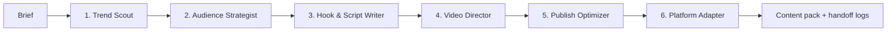

# Sansi — Content Agent Network

**Agent network, not a web app.** Six specialized AI agents share context through an orchestrator. Run locally from the command line, or directly in GitHub Actions. No frontend, server, browser or runtime packages required. Node.js 22+.

## Network / handoffs



Each agent receives **the original brief and every completed upstream agent's structured output**, not just an isolated prompt. The adapter therefore sees the researched angle, strategy, script, visual plan and publishing package. Execution is sequential and fail-fast: if an agent fails, downstream agents do not run and no demo content is substituted.

| Agent | Responsibility | Deliverables |
|---|---|---|
| Trend Scout | Analyze topic and supplied current-trend evidence | Trend assessment, angles, audience questions, uncertainty |
| Audience Strategist | Decide who the content is for and why they should care | Audience, chosen angle, promise, retention strategy, metrics |
| Hook & Script Writer | Write the video | Three hooks, timestamped spoken script, payoff, CTA, verification notes |
| Video Director | Design production | Shot list, B-roll, on-screen text, sound, editing, checklist |
| Publish Optimizer | Package the primary platform | Titles, caption, description, hashtags, thumbnail, pinned comment |
| Platform Adapter | Repurpose per social network | Distinct Instagram Reels, YouTube Shorts, YouTube long-form, TikTok, Facebook Reels, LinkedIn and X packages |

Platform packages include native hooks/copy, CTA, format suggestions, hashtags and edit notes. YouTube long-form gets an expanded outline, not a falsely labelled finished long video; X gets a standalone post and optional thread outline.

## Run locally

```sh
# Explicit offline demonstration (no AI key, no API calls):
npm run agents -- --brief briefs/example.json --demo

# Inspect the agent graph and input/output contracts:
npm run agents -- --describe

# Real AI agents:
cp .env.example .env
# Set OPENAI_API_KEY in .env locally, then:
npm run agents -- --brief briefs/example.json
```

Edit `briefs/example.json` or pass a different JSON file. Supported fields: `topic` (required), `audience`, `language`, `platform`, `duration`, `goal`, `evidence`. Inputs have length/type validation. API keys must never go in the brief or committed files.

`OPENAI_MODEL` defaults to `gpt-4o-mini`. `OPENAI_BASE_URL` defaults to `https://api.openai.com/v1`; compatible providers must implement chat completions with JSON-object response mode. Your brief and upstream results are sent to this provider. No API key means an error unless `--demo` is explicitly selected. Actual paid provider execution has not been verified in this workspace.

### Output files

Every run gets its own directory under ignored `runs/` (override with `--output path`):

```text
runs/<timestamp>-<id>/
  network.json       # Agent graph, receives/produces contracts
  status.json        # running / complete / failed
  handoffs.ndjson    # Timestamped handoffs, context IDs, results and errors
  scout.json
  strategist.json
  writer.json
  director.json
  publisher.json
  adapter.json
  content-pack.json # All outputs and original brief
  content-pack.md   # Readable final deliverable
```

Completed upstream files remain available if a later step fails. An incomplete run has no successful final pack and exits nonzero. Logs and packs contain brief/output content: keep them private where appropriate. Runs time out after ten minutes and support interruption with Ctrl+C. There is no resume mechanism; retry starts a fresh run and may incur provider charges.

## Run on GitHub

After the workflow is present on the default branch:

1. For real AI, add **`OPENAI_API_KEY` as a repository Actions secret** under Settings → Secrets and variables → Actions. Do not paste it into issues, briefs or chat. Optionally add repository variable `OPENAI_MODEL`.
2. Open **Actions → Run content agent network → Run workflow**.
3. Enter the topic, language and dated trend evidence. `demo` defaults to true to avoid accidental API charges; turn it off for real AI.
4. Download the **`content-agent-network-<run-id>`** artifact for the content pack and handoff logs. Artifacts are retained for 14 days. Failed runs upload available partial outputs too.

Manual-dispatch workflows normally need to exist on the default branch to appear in the Actions UI. The PR adds them; merging is a separate step. CI runs `npm test` on pushes and pull requests without API credentials. The content workflow runs only on manual dispatch, not on untrusted pull requests.

## Current trends: explicit boundary

**Automatic live trend discovery is not implemented.** Neither the AI nor demo can verify what is trending right now. Put recent dated excerpts, observations and source URLs into `evidence`. The Scout analyzes that text but does not fetch links or independently verify popularity. A live search/trends feed integration is a separate requirement; there are no fabricated trend scores, current posting times or reach guarantees.

Demo mode uses generic English/Hinglish illustrative templates, not topic research. Hindi-only generation requires AI mode; Hindi selection in demo uses Hinglish. Demo script timestamps scale, but the template is roughly 60 seconds: time a read-through and edit for your selected duration. All final content needs fact-checking, license checks and a production review.

## Development

- `agents.js`: six roles, instructions, output schemas, provider calls and explicit demo templates.
- `network.js`: agent graph, shared-context handoffs, orchestration and Markdown renderer.
- `cli.js`: headless runner, artifacts, status and logs.
- `.github/workflows/content-network.yml`: manual GitHub runner.
- `.github/workflows/test.yml`: credential-free CI.

```sh
npm test
```

Tests cover input validation, six output schemas, platform packages, actual context propagation through an injected executor, fail-fast behavior, cancellation, CLI artifacts and missing-key errors. No web application is included.
